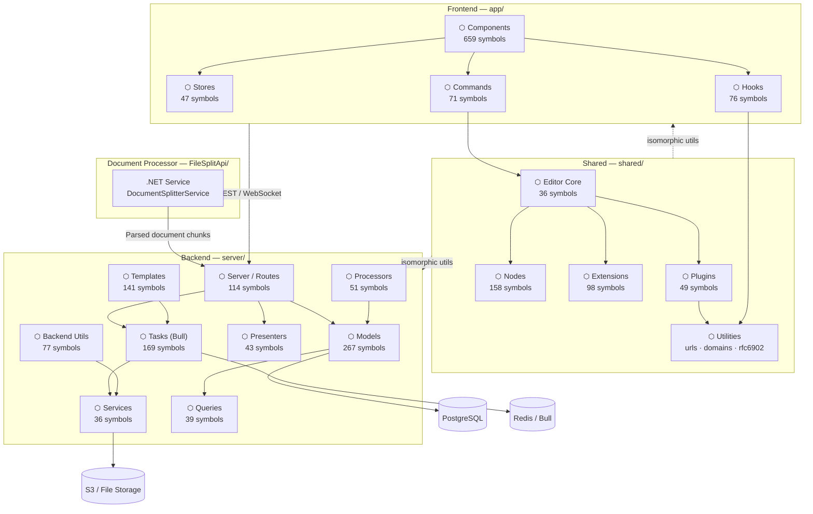

# Outline — Architecture Documentation

> Generated from GitNexus knowledge graph (11,479 symbols · 2,401 files · 300 execution flows)
> Note: Index is 33 commits behind HEAD — run `npx gitnexus analyze` to refresh.

---

## Overview

Outline is a full-stack knowledge-base and wiki application with a rich collaborative document editor. The codebase spans four distinct runtime boundaries:

| Layer | Stack | Location |
|---|---|---|
| **Frontend** | React + MobX + ProseMirror | `app/` |
| **Shared** | TypeScript (isomorphic) | `shared/` |
| **Backend API** | Node.js / Express | `server/` |
| **Document Processor** | .NET (C#) | `FileSplitApi/` |

---

## Functional Areas

| Module | Symbols | Cohesion | Role |
|---|---|---|---|
| **Components** | 659 | 78% | React UI — pages, panels, dialogs, sidebar |
| **Models** | 267 | 83% | ORM models — Document, Collection, User, Team… |
| **Tasks** | 169 | 71% | Background jobs (Bull queues) |
| **Nodes** | 158 | 79% | ProseMirror document node definitions |
| **Templates** | 141 | 85% | Email & document templates |
| **Scripts** | 117 | 82% | Build & maintenance CLI scripts |
| **Server** | 114 | 82% | Express routes, middlewares, auth |
| **Extensions** | 98 | 78% | ProseMirror editor extensions |
| **Backend** | 77 | 86% | Backend utilities & integrations |
| **Hooks** | 76 | 71% | React hooks (state, effects, editor) |
| **Commands** | 71 | 68% | Editor keyboard commands |
| **Processors** | 51 | 81% | Document import/export processors |
| **Plugins** | 49 | 88% | ProseMirror plugins |
| **Stores** | 47 | 86% | MobX state stores |
| **Presenters** | 43 | 75% | API response serializers |
| **Queries** | 39 | 72% | Reusable database queries |
| **Test** | 36 | 96% | Test utilities & factories |
| **Editor** | 36 | 79% | Editor core configuration |
| **Services** | 36 | 69% | External service adapters (S3, email…) |
| **Rfc6902** | 35 | 76% | JSON Patch (RFC 6902) implementation |

> Showing top 20 of 63 modules.

---

## Key Execution Flows

### 1. Upload Plugin — URL Validation (9 steps)
**Path:** `UploadPlugin.constructor → Pointer`

Triggered when the editor initializes the upload plugin. Maps uploaded nodes through URL validation and normalizes domains before applying JSON patch operations.

```
UploadPlugin.ts : constructor
  → mapNode
    → isInternalUrl          (shared/utils/urls.ts)
      → parseDomain          (shared/utils/domains.ts)
        → getBaseDomain
          → normalizeUrl
            → replace        (shared/utils/rfc6902/patch.ts)
              → fromJSON     (shared/utils/rfc6902/pointer.ts)
                → Pointer
```

### 2. Passport Auth Middleware — Sign-In (8 steps)
**Path:** `CreateMiddleware → Pointer`

The OAuth/Passport middleware flow that handles sign-in. Resolves the cookie domain for multi-tenant setups by parsing the host domain before writing the session.

```
passport.ts : createMiddleware
  → signIn                   (server/utils/authentication.ts)
    → getCookieDomain        (shared/utils/domains.ts)
      → parseDomain
        → normalizeUrl
          → replace          (shared/utils/rfc6902/patch.ts)
            → fromJSON       (shared/utils/rfc6902/pointer.ts)
              → Pointer
```

### 3. Document Splitting — .NET Pipeline (6 steps)
**Path:** `SplitDocumentAsync → GetParagraphPlainText`

The .NET microservice that imports DOCX/PPTX files. Parses documents into structured sections, extracts table content, converts notice blocks, and yields plain text per paragraph.

```
DocumentSplitterService.cs : SplitDocumentAsync
  → ParseDocument
    → ParseDocumentWithoutHeadings
      → ExtractTableContent
        → TryConvertToNoticeBlock
          → GetParagraphPlainText
```

### 4. Table Plugins — Health & Shutdown (6 steps)
**Path:** `Plugins → Execute`

Cross-cutting flow connecting ProseMirror table plugins through server-side health monitoring to the graceful shutdown helper.

```
TableHeader.ts : plugins
  → selectColumn             (shared/editor/commands/table.ts)
    → colSelection           (shared/editor/selection/ColumnSelection.ts)
      → start                (server/queues/HealthMonitor.ts)
        → fatal              (server/logging/Logger.ts)
          → execute          (server/utils/ShutdownHelper.ts)
```

### 5. Editor Click Handlers — URL Routing (8 steps)
**Path:** `UseEditorClickHandlers → Pointer`

React hook that intercepts clicks inside the document editor. Detects internal links and routes them via the SPA router instead of full page navigation.

```
useEditorClickHandlers.ts
  → isInternalUrl            (shared/utils/urls.ts)
    → parseDomain            (shared/utils/domains.ts)
      → getBaseDomain
        → normalizeUrl
          → replace          (shared/utils/rfc6902/patch.ts)
            → fromJSON       (shared/utils/rfc6902/pointer.ts)
              → Pointer
```

---

## Architecture Diagram



---

## Cross-Cutting Concerns

| Concern | Implementation |
|---|---|
| **Authentication** | Passport.js OAuth middleware (`server/middlewares/passport.ts`) with multi-tenant cookie domain resolution via `shared/utils/domains.ts` |
| **Real-time collaboration** | WebSocket connections handled by the server layer, editor state managed through ProseMirror plugins |
| **URL safety** | All internal/external URL checks funnel through `shared/utils/urls.ts → parseDomain → normalizeUrl` before any patch or routing decision |
| **JSON Patching** | RFC 6902 implementation (`shared/utils/rfc6902/`) used by both the editor (node diffing) and auth flows (session patching) |
| **Background jobs** | Bull queue backed by Redis; health monitored by `HealthMonitor` with `ShutdownHelper` for graceful drain |
| **Document import** | DOCX/PPTX files routed through the .NET `FileSplitApi` microservice which splits them into structured chunks before ingestion |
| **State management** | MobX stores on the frontend; Sequelize ORM models on the backend |

---

*Documentation generated by GitNexus on 2026-03-25.*
