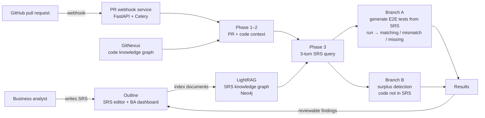

# SRS–Code Drift Detector

An AI agent system that keeps software requirements and source code in sync. Every pull request is checked
against the project's Software Requirements Specification (SRS). The system reports where the code no
longer matches the requirements, and a business analyst reviews each finding on a dashboard before
anything is changed.

> **Graduation thesis, FPT University (Software Engineering, 2026) · Grade 9.3/10**
> *Analysis and Implementation of an AI Agent System for Supporting Software Requirements Maintenance
> Through SRS–Source Code Drift Detection and Reviewable Adjustment Recommendations*

The system is built on top of [Outline](https://github.com/outline/outline), an open-source team knowledge
base, which serves as the place where SRS documents are written and where analysts review the results.

---

## The problem

Requirements documents and code drift apart. A developer changes an endpoint, adds a feature nobody asked
for, or leaves a use case half-implemented, and the SRS still describes the old behaviour. Nobody notices
until testing or production. Checking this by hand on every pull request does not scale.

## How it works



1. **SRS indexing.** Analysts write use cases in Outline. Documents are split (FileSplitApi) and indexed into a
   LightRAG knowledge graph stored in Neo4j, so requirements can be retrieved by meaning rather than keywords.
2. **Pull request trigger.** A GitHub webhook queues every pull request (RabbitMQ + Celery). GitNexus keeps a
   code knowledge graph of the repository, and a per-repo `.lightrag-config.yml` tells the pipeline which
   layers (services, controllers, UI) to pull in as context.
3. **SRS retrieval.** A three-turn query finds the use cases a pull request touches, fetches their full text,
   and narrows them down to the affected requirements.
4. **Branch A: does the code do what the SRS says?** An LLM generates Playwright end-to-end tests *from the SRS
   only* (the code diff is deliberately hidden from it), then the tests run against the application. Each
   requirement is tagged **matching**, **mismatch** (wrong behaviour) or **missing** (not implemented).
5. **Branch B: does the code do more than the SRS says?** A second agent reads both the diff and the SRS and
   flags behaviour that no requirement describes (**surplus**).
6. **Human review.** Findings are pushed to a BA dashboard inside Outline, linked to the pull request. The
   analyst approves or rejects each suggested SRS adjustment, so the documentation is never rewritten
   automatically.

Other features built for the thesis: chat over the SRS knowledge graph, an AI-assisted Kanban board,
per-workspace LLM credentials, and LLM cost tracking per pipeline run.

## Architecture

| Service | Stack | Location |
|---|---|---|
| Outline app (SRS editor, BA dashboard) | TypeScript, React, Node.js, PostgreSQL | `app/`, `server/`, `shared/` |
| RAG backend | Python, FastAPI, LightRAG, Neo4j | `backend/` |
| Gap-finding pipeline | Python, FastAPI, Celery, RabbitMQ, Playwright | `gap_finding_module/` |
| Code knowledge graph | Node.js, GitNexus | `gitnexus-service/` |
| Document splitter | C#, .NET | `FileSplitApi/` |
| LLM gateway | Go ([CLIProxyAPI](https://github.com/router-for-me/CLIProxyAPI), third-party) | `CLIProxyAPI/` |

## Running locally

Requirements: Docker and Docker Compose, a Google Cloud Storage bucket (or switch `FILE_STORAGE` to local),
and API keys for an LLM (Gemini by default) and an embedding model.

```bash
cp .env.sample .env.production      # fill in the [REQUIRED] values
cp /path/to/your-gcs-key.json ./gcs-credentials.json
docker compose up -d --build        # first build takes 10–15 minutes
```

See [`deploy/README.md`](deploy/README.md) for the full setup, including Nginx and HTTPS.

## Credits and license

- [Outline](https://github.com/outline/outline) by General Outline, Inc. is licensed under the
  [Business Source License 1.1](LICENSE). This repository is a modified version for academic,
  non-commercial use. The original README is kept in [`docs/OUTLINE_README.md`](docs/OUTLINE_README.md).
- [CLIProxyAPI](https://github.com/router-for-me/CLIProxyAPI) is included under its MIT license
  ([`CLIProxyAPI/LICENSE`](CLIProxyAPI/LICENSE)).
- [LightRAG](https://github.com/HKUDS/LightRAG) and [GitNexus](https://github.com/abhigyanpatwari/GitNexus)
  are used as dependencies.

This public repository is a clean snapshot of the team's private development repository. Commit history,
credentials and project data were removed before publishing.
